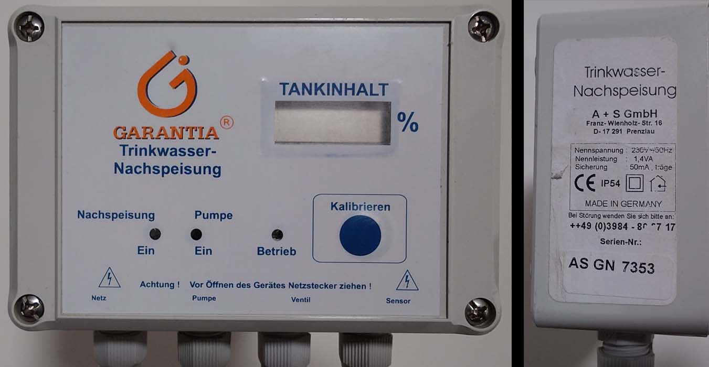
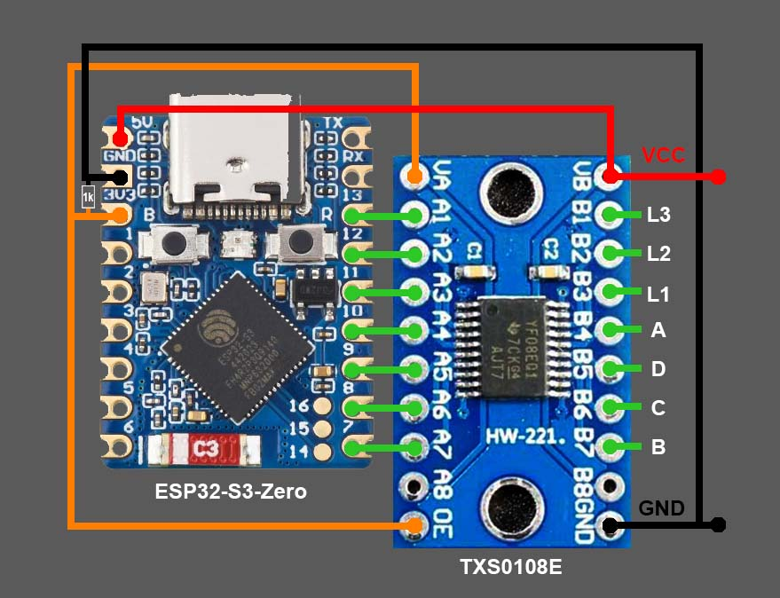
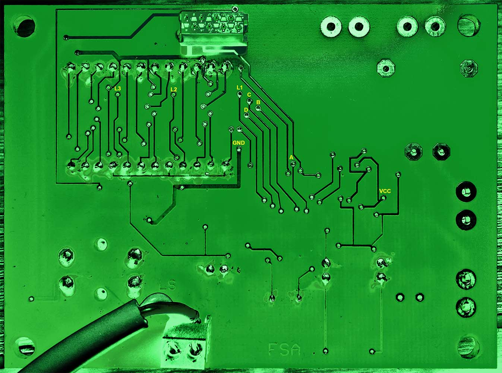
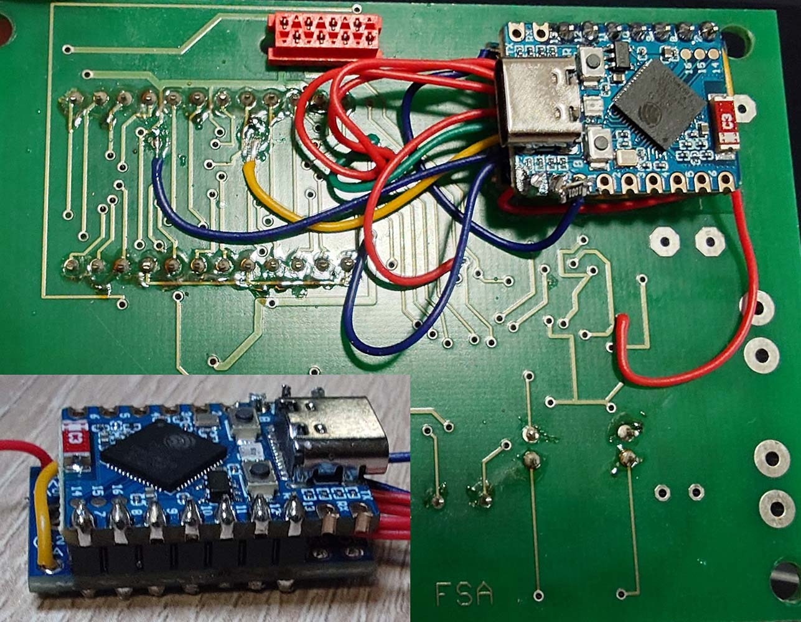
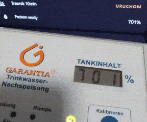
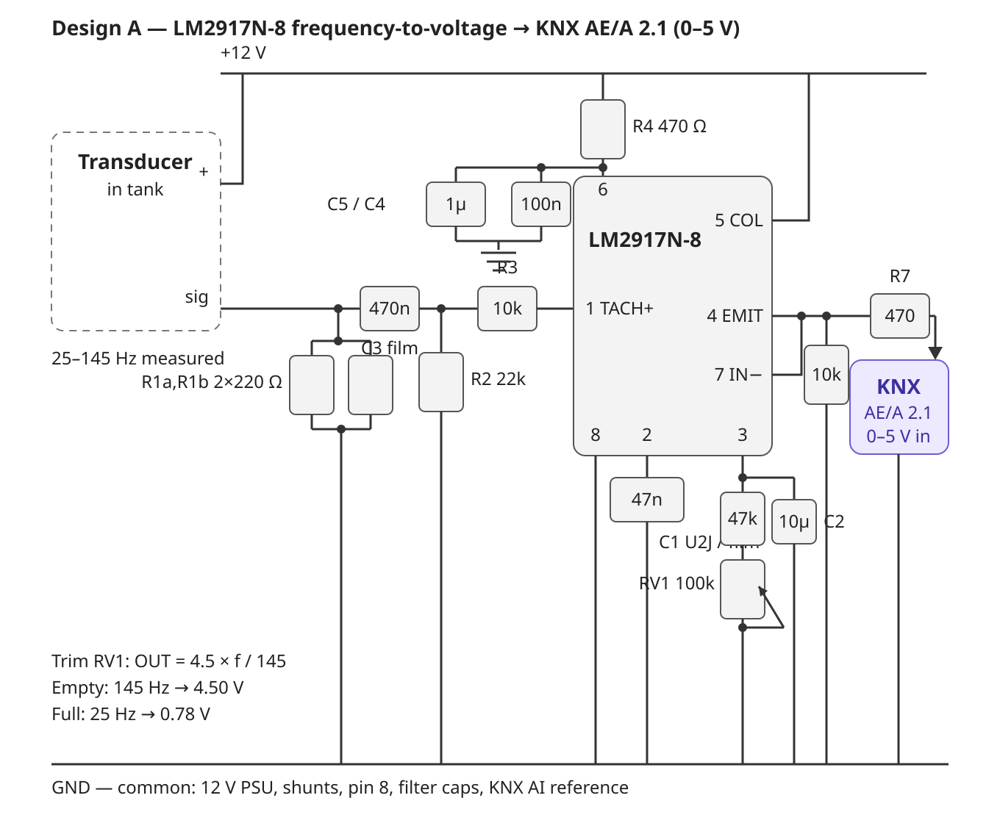
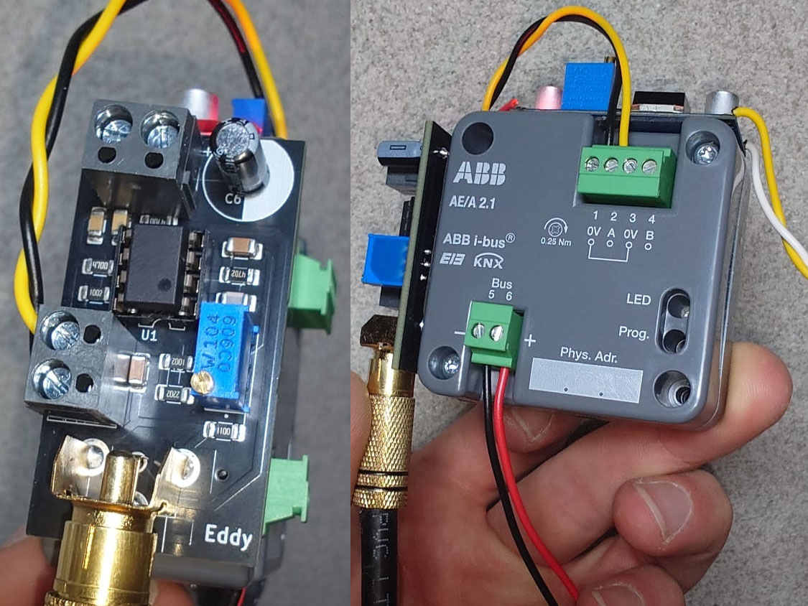
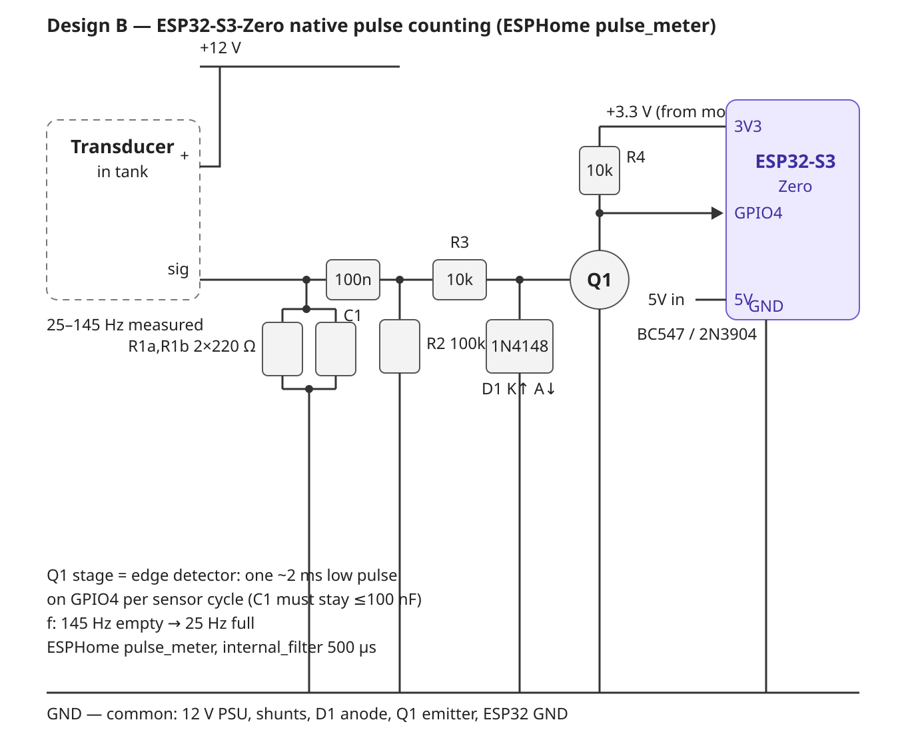
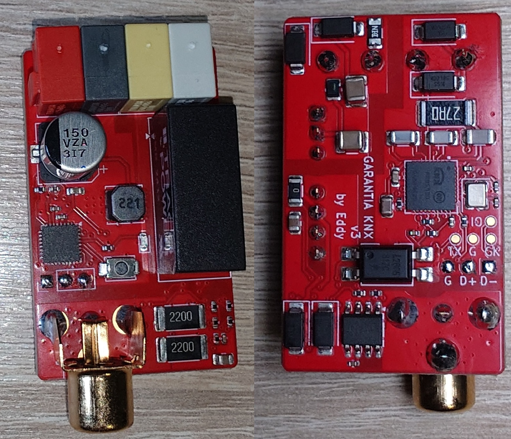

# Garantia water tank level sensor for ESPHome / KNX

So you have an old-fashioned water tank level module like this one



and you want to see the percentage in your Home Assistant dashboard? Let's do it!

Three ways to get there:

- **V1** – keep the original controller, sniff its display signals with an ESP32 (below).
- **V2** – replace the controller with a small board that talks to the tank sensor directly:
  analog 0–5 V output (KNX or ESP32 ADC), or ESP32 pulse counting with a single transistor. [Jump to V2](#v2--replacing-the-controller).
- **V3** – a KNX device of its own: one small board on the KNX bus that powers the sensor and reports level, frequency
  and faults straight to KNX, with calibration from Home Assistant and a safe top-up valve control. [Jump to V3](#v3--knx-device).

---

# V1 – reading the original controller

## 0. [What? How?](HOW.md)

## 1. Required hardware
- [ESP32-S3-Zero](https://www.waveshare.com/esp32-s3-zero.htm)
- [TXS0108E](https://aliexpress.com/i/4001172918547.html)

## 2. Connections




You also have to replace the on-board voltage regulator **8L05A** to a more powerful one [KF50BD-TR](https://www.st.com/resource/en/datasheet/kfxx.pdf)

## 3. ESPHome component

```yaml
esphome:
  name: garantia-water-level
  platformio_options: # needed for ESP32-S3
    board_build.flash_mode: dio

esp32:
  board: adafruit_feather_esp32s3
  framework:
    type: esp-idf

external_components:
  - source: github://AdrianEddy/esphome-garantia-water-level
    components: [ garantia-water-level ]

sensor:
  - platform: garantia-water-level
```

## Final assembly



## See it in action



---

# V2 – replacing the controller

The tank-side electronics (the small box in the tank + the red/white sensor cord) are fine and stay untouched.
Only the indoor box gets replaced.

## What the sensor actually does (research, short version)

Reverse-engineered from the original PCB and measured with a scope – **the manual is misleading here**:

- The tank box is a capacitance-to-frequency converter on a **2-wire current loop**: the controller sends +12 V on one RCA contact, the sensor's return current comes back on the other contact through a **110 Ω shunt** (2×220 Ω on the original PCB). The current is pulsed – that's the signal.
- Signal across the shunt: **≈1.7 V pk-pk**, square-ish, ~35/65 duty, on ~3 V DC (the sensor draws ≈27 mA).
- **Frequency: ~145 Hz with an empty tank, ~25 Hz with a full tank.** More water → lower frequency.
  The "200 Hz – 20 kHz" in the manual is *not* what comes down the cable – ignore it.
- Level is **linear in period**, not frequency: `level = (1/f − 1/f_empty) / (1/f_full − 1/f_empty)`.
- The original controller is an ATtiny2313 counting that frequency with its internal comparator. No magic.

Conclusions that saved parts:
- The signal is big enough that **no comparator is needed** – an LM2917 or a single transistor reads it directly.
  (Only if your sensor variant gives < 300 mVpp would you need an LM393-style comparator in front.)
- The one critical component is the LM2917 timing cap C1 – it sets the gain: **C0G / U2J / film only**, never X7R.
- Frequencies are installation specific (cord length, tank). **Measure yours** before picking values.
- If your original controller reads unstable, check its wall adapter first – ours had sagged to 10 V.

## Measure your sensor first

1. Power the tank box with 12 V through a 110 Ω shunt to GND (the V2 board does exactly this).
2. Scope across the shunt, **AC coupling**, 0.5 V/div, 10 ms/div. Note the frequency.
3. Record `f_empty` (pump can't take more out) and `f_full` (water at the overflow). Optional sanity check:
   a period-linear sensor sits at `2 / (1/f_empty + 1/f_full)` at 50 % (≈43 Hz for 145/25).

Everything below is parameterised on `f_empty` and `f_full`.

## Which option?

| You want | Use |
|---|---|
| An **analog 0–5 V signal** – KNX analog input (e.g. ABB AE/A 2.1) or ESP32 ADC | **Option A – LM2917** |
| Just an ESP32 in Home Assistant, best accuracy, fewest parts | **Option B – transistor + `pulse_meter`** |

Common to both: 12 V DC supply, RCA jack (contact A = +12 V feed, contact B = signal), 110 Ω shunt from signal to GND, one common GND.

**Power:** a Mean Well HDR-15-12 works, but in the KNX version I skipped the extra PSU altogether: the **yellow/white pair** of the KNX cable
carries the 30 V *auxiliary* (unchoked) output of the KNX power supply, and **Traco Power TMR 2412** drops it to 12.0 V.
 The board draws ~20 mA at 30 V. Take it only from the auxiliary output / yellow-white pair – **never from the
red/black bus pair**, which carries the telegrams and must not see a switching load. **Do not** use a cheap DC-DC buck module (LM2596-type) - 12V GND MUST be isolated from KNX GND

---

### Option A – LM2917 frequency-to-voltage (KNX / analog)



**KiCad project (schematic + PCB, JLCPCB-ready):** [hardware/garantia-lm2917-kicad.zip](hardware/garantia-lm2917-kicad.zip)
– the 1206/SOIC parts can be assembled by JLCPCB PCBA; DIP LM2917, trimmer and connectors are hand-soldered.



Transfer function: **V_OUT = 7.56 V × f × C1 × R1**. Design for ~4.5 V at `f_empty` (headroom below the 5 V input range):

```
C1 × R1 = 4.5 / (7.56 × f_empty)          # f_empty = 145 Hz → 4.1e-3
pick C1 so R1 lands mid-trimmer (47k fixed + 100k trim):  145 Hz → C1 = 47 nF, R1 ≈ 87 k
charge-pump limit:  f_empty < 140e-6 / (C1 × 7.56)        # 47 nF → 394 Hz max
```

Values as built (f_empty 145 Hz, f_full 25 Hz):

| Ref | Value | Notes |
|---|---|---|
| R1 | 110 Ω (or 2×220 Ω) | shunt |
| C3, R2, R3 | 470 nF film, 22 k, 10 k | AC coupling into pin 1 |
| R4, C4, C5 | 470 Ω, 1 µF, 100 nF | pin 6 (internal 7.56 V zener) |
| C1 | **47 nF C0G / U2J / film** | pin 2 – gain critical |
| R5 + RV1, C2 | 47 k + 100 k trimmer (rheostat), 10 µF | pin 3 – gain trim + filter |
| R6, R7 | 10 k, 470 Ω | output load + series; pin 7 strapped to pin 4, pin 5 to +12 V |

Output: empty 145 Hz → **4.50 V**, full 25 Hz → **0.78 V**. Voltage at level L: `V = 4.5 / (1 + (f_empty/f_full − 1)·L)`.

**Trim:** turn RV1 until `OUT = 4.5 × f / f_empty` at any known frequency (full tank → 0.78 V).

**KNX (ABB AE/A 2.1):** channel = voltage 0–5 V, output as 4-byte float, lower 0 % → 0, upper 100 % → 5 (bus value = volts).
Filter *low* (the 64-sample filter turns a sensor failure into a 60 s fake "filling" ramp). Send on change ≥1 % + cyclic 5 min.
Threshold 1 (valve): ON above 3.04 V (10 %), OFF below 2.86 V (12 %). Threshold 2 (fault): ON below 0.40 V.

**Home Assistant (KNX):**
```yaml
knx:
  sensor:
    - name: "Tank voltage"
      state_address: "5/3/4"
      type: 4byte_float
      device_class: voltage

template:
  - sensor:
      - name: "Rainwater tank level"
        unit_of_measurement: "%"
        state_class: measurement
        state: >
          
             {# voltage at f_empty #}
             {# voltage at f_full  #}
          {{ none }}
          {{ [0, [100, ((1/v - 1/ve) / (1/vf - 1/ve) * 100) | round(0)] | min] | max }}
          
  - binary_sensor:
      - name: "Rainwater tank sensor fault"
        device_class: problem
        state: "{{ states('sensor.tank_voltage') | float(0) < 0.4 }}"
```

**ESP32 ADC instead of KNX:** 10 k / 10 k divider from OUT to GND, tap → GPIO4 (ADC1), common GND.
```yaml
sensor:
  - platform: adc
    pin: GPIO4
    id: tank_v
    attenuation: 12db
    update_interval: 1s
    filters:
      - median: { window_size: 15, send_every: 5 }
      - multiply: 2.0
  - platform: template
    name: "Rainwater tank level"
    unit_of_measurement: "%"
    lambda: |-
      const float VE = 4.50, VF = 0.78;
      float v = id(tank_v).state;
      if (v < 0.4) return NAN;
      return clamp((1.0f/v - 1.0f/VE) / (1.0f/VF - 1.0f/VE) * 100.0f, 0.0f, 100.0f);
```
(The ESP32 ADC is coarse below ~0.15 V – fine for a tank; KNX or Option B is more accurate near full.)

---

### Option B – one transistor + ESPHome (pulse counting)



```
shunt node ─ 100 nF ─┬─ 10k ─┬─ base Q1 (BC547 / MMBT3904)
                     │       └─ D1 1N4148 (cathode at base, anode GND)
                    100k         emitter → GND
                     │           collector ─┬─ 10k → +3.3 V (from the ESP module)
                    GND                     └─ GPIO4
```
The stage is an edge detector: one ~2 ms low pulse on GPIO4 per sensor cycle. **Keep the coupling cap ≤ 100 nF** – a bigger one merges pulses at high frequency.
Power the ESP32-S3-Zero from USB or a 12 V→5 V buck; common GND with the sensor board.

```yaml
sensor:
  - platform: pulse_meter
    pin:
      number: GPIO4
      mode: INPUT
    id: tank_pulse
    name: "Tank sensor frequency"
    unit_of_measurement: "Hz"
    internal_filter: 500us     # pulses are ~2 ms – do NOT use 2 ms
    timeout: 250ms             # no pulse for 250 ms = sensor fault
    filters:
      - multiply: 0.016667     # pulses/min → Hz
      - sliding_window_moving_average: { window_size: 10, send_every: 5 }

  - platform: template
    name: "Rainwater tank level"
    unit_of_measurement: "%"
    state_class: measurement
    update_interval: 10s
    lambda: |-
      const float F_EMPTY = 145.0, F_FULL = 25.0;   // measure yours
      float f = id(tank_pulse).state;
      if (isnan(f) || f < 5.0) return NAN;
      return clamp((1.0f/f - 1.0f/F_EMPTY) / (1.0f/F_FULL - 1.0f/F_EMPTY) * 100.0f, 0.0f, 100.0f);

binary_sensor:
  - platform: template
    name: "Rainwater tank sensor fault"
    device_class: problem
    lambda: return isnan(id(tank_pulse).state) || id(tank_pulse).state < 5.0;
```

Calibration = two constants. Uniform ~1 % resolution across the whole tank, no trimmer, no critical parts.

---

## Top-up valve

Drive it separately from Home Assistant Automation, using any standard output (KNX, ESPHome relays, Tuya etc)

## Debugging notes (things that cost us time)

- Measure frequency at the **shunt**, not at LM2917 pin 1 – the coupling network droops the waveform at low frequency and confuses scope counters.
- A half-full tank gives only a few hundred mV out of the LM2917 – that is correct, the scale is nonlinear (all the resolution sits at the empty end, where the valve decisions are).
- "Empty" depends on residual water on the probe (we saw 125 vs 145 Hz ≈ 3 % of level). Calibrate to your pump-limit state.

---

# V3 – KNX device

One small board instead of V2 + an analog KNX input module: it plugs into the KNX bus and the 30 V auxiliary pair,
powers the tank sensor itself, measures its frequency and reports the level straight to KNX. No ESP32, no WiFi.



## What it does

- **KNX device on its own:** NCN5130 transceiver + STM32G0B1 running [thelsing/knx](https://github.com/thelsing/knx), powered from the bus (10 mA).
- **Powers the sensor** from the yellow/white 30 V auxiliary pair through a **Traco TMR 2412** (isolated 12 V). The garden cable never becomes part of the KNX line.
- **Reads the sensor like the original controller** (12 V feed, 110 Ω shunt), slices the signal with an LM2903 comparator and sends it across the isolation barrier through an LTV-817S optocoupler.
- **Measures the period against the NCN5130's crystal** (≤ 50 ppm), not the STM32's RC oscillator (up to 3 % off in a cold garage).
- **KNX objects:** level %, frequency, volume, sensor fault, low-level alarm, calibration (write the two frequencies, or press "tank is empty / full now"), and a **top-up valve** with safety limits.
- **Flashing over USB** through the STM32's own ROM bootloader (DFU). No programmer needed.

## How it works

Three galvanically separate domains on a 28 × 46 mm, 4-layer board, kept 2 mm apart on every layer:

```
 KNX bus (red/black) ──► NCN5130 ──► 3.3 V ──► STM32G0B1 ◄── XCLK 8 MHz from the NCN5130's crystal
                                                   ▲
                                                   │  LTV-817S optocoupler (5 kV)
                                                   │
 aux 30 V (yellow/white) ─► TMR 2412 ─► 12 V ─► RCA tip ─► sensor ─► RCA shell ─► 110 Ω shunt ─► LM2903
                            (1.6 kV)                           (floating sensor domain)
```

- **Why isolated:** inside the KNX power supply the aux minus is tied to the bus minus, and the sensor cable lies
  underground in a wet tank. A cheap non-isolated buck would make that cable part of the KNX line (see V2's power note).
- **The RCA shell is the signal**, not ground (as on the original controller), so the jack floats with the sensor domain.
- **The comparator** compares the shunt voltage with its own long-term average (0.5 s), with hysteresis. It needs no
  coupling capacitor, so it works from 25 to 145 Hz alike, and a shorted or open cable simply stops the pulses → "sensor fault".
- **The level** is linear in period: `level = (1/f − 1/f_empty) / (1/f_full − 1/f_empty)` (defaults 145 / 25 Hz, set in ETS or from Home Assistant).

Details, values and reasons: [v3/design.md](v3/design.md).

## Files

| | |
|---|---|
| Design document | [v3/design.md](v3/design.md) |
| KiCad 10 project | [v3/hardware/kicad](v3/hardware/kicad) – schematic, 4-layer PCB, design rules incl. the isolation rules, libraries |
| JLCPCB package | [v3/fab/jlcpcb-2026-10-17-a](v3/fab/jlcpcb-2026-10-17-a) – Gerbers, BOM, CPL, [ORDER-NOTES.md](v3/fab/jlcpcb-2026-10-17-a/ORDER-NOTES.md) |
| Firmware source | [v3/firmware](v3/firmware) – STM32 boot manager + KNX application, `.knxprod` generator, flash kit ([README](v3/firmware/README.md)) |
| Built firmware + `.knxprod` | [v3/release/firmware-1.2](v3/release/firmware-1.2) |

## Building one

- **PCB + assembly:** JLCPCB, 4 layers, both sides assembled (54 SMD parts). Everything to fill in is in
  [ORDER-NOTES.md](v3/fab/jlcpcb-2026-10-17-a/ORDER-NOTES.md). Check the **STM32G0B1KCU6** stock first: it was out of
  stock in October 2026; the KCU7 is a drop-in.
- **Hand-soldered:**
  - 2 × 2 WAGO 243-131 pins for the WAGO 243-211 (bus, red/grey) and 243-212 (aux, yellow/white) plugs;
  - the Traco TMR 2412 (TMR 3-2412 fits);
  - a Keystone 900 RCA jack;
  - a USB-C breakout on J3 for flashing.
- **Before the first power-up:** the ohmmeter checks in [design.md](v3/design.md) ("PCB layout rules", "Hand-soldering").

## Flashing

USB doesn't power the board: put it on the KNX bus (red/black), plug a USB cable into the breakout on J3, and **run the laptop on battery** – J3's ground is the KNX minus.

- **New board:** it starts in DFU by itself → flash `garantia-knx-u3-full.hex`.
- **Updates:** hold the button (SW1) for 3–10 s and release → DFU → flash `garantia-knx-u3-app.hex`.
- `dfu-util -d 0483:df11 -a 0 -s 0x08001000:leave -D garantia-knx-u3-app.bin`, or STM32CubeProgrammer, or the
  portable [flash kit](v3/firmware/flashkit) (Windows + macOS scripts that check everything first).

Full procedure: [v3/firmware/README.md](v3/firmware/README.md#flashing-usb-dfu).

## ETS

Import [garantia-knx.knxprod](v3/release/firmware-1.2/garantia-knx.knxprod) (manufacturer 0x00FA, "Garantia tank level"),
press SW1 briefly (red LED on) to program the individual address, then download the application.
Calibration defaults to 145 Hz empty / 25 Hz full; top-up control and the low-level alarm are off until you enable them.

## Home Assistant (KNX)

```yaml
knx:
  sensor:
    - name: "Rainwater tank level"          # object 1, DPT 8.010 (0.01 %)
      state_address: "5/3/12"
      type: percentV16
      state_class: measurement
      sync_state: init
    - name: "Rainwater tank frequency"      # object 2, DPT 14.033
      state_address: "5/3/13"
      type: frequency
      device_class: frequency
      state_class: measurement
      sync_state: init
    - name: "Rainwater tank volume"         # object 3, DPT 12.1200 (set "Tank volume" in ETS)
      state_address: "5/3/18"
      type: volume_liquid_litre
      device_class: volume_storage
      state_class: measurement
      sync_state: init
  binary_sensor:
    - name: "Rainwater tank sensor fault"   # object 4, DPT 1.005
      state_address: "5/3/17"
      device_class: problem
      sync_state: init
    - name: "Rainwater tank low"            # object 5, DPT 1.005 (set "Low-level alarm below" in ETS)
      state_address: "5/3/16"
      device_class: problem
      sync_state: init
  number:                                   # objects 6/7, DPT 14.033: show and set the calibration
    - name: "Rainwater tank f empty"
      address: "5/3/19"
      state_address: "5/3/19"
      type: frequency
      min: 15
      max: 180
      step: 0.1
      mode: box
    - name: "Rainwater tank f full"
      address: "5/3/20"
      state_address: "5/3/20"
      type: frequency
      min: 15
      max: 180
      step: 0.1
      mode: box
  button:                                   # objects 8/9, DPT 1.017: teach the current frequency
    - name: "Rainwater tank is empty now"
      address: "5/3/15"
      payload: 1
    - name: "Rainwater tank is full now"
      address: "5/3/14"
      payload: 1
```

Use your own group addresses. A teach-in is refused (the number entity then keeps its value) while the reading isn't
valid, e.g. right after power-up or during a sensor fault.

The frequency arrives as a full float, but Home Assistant displays sensors of the `frequency` device class in whole Hz
by default (the KNX integration always gives DPT 14.033 that class). To see the decimals, open the sensor's settings
and set *Display precision*, e.g. 43.27. The level (DPT 8.010) has no device class and shows its decimals as is.

## Top-up valve

Turn on "Top-up valve control" in ETS and link object 10 to a KNX switching actuator channel set to a **staircase /
timeout function** (e.g. 5 min). The board then:

- opens below 10 % and closes at 12 % (adjustable);
- repeats ON every minute while filling, so the valve closes by itself if the board or the bus dies;
- closes on a sensor fault and locks (alarm on object 12) after 30 min of opening per fill, or when the level doesn't rise
  by 1 % within 10 min – a burst pipe or a dry supply doesn't flood the garden;
- is enabled / disabled from Home Assistant through object 11 (switching it off and on again also clears a lock);
- keeps the lock, the enable and the fill time across power cuts.

```yaml
knx:
  switch:
    - name: "Rainwater tank top-up"         # object 11, DPT 1.003
      address: "5/3/21"
      state_address: "5/3/21"
  binary_sensor:
    - name: "Rainwater tank top-up fault"   # object 12, DPT 1.005
      state_address: "5/3/22"
      device_class: problem
```
